# Kopi dan Nyemil

### Ujian Tengah Semester — Pengembangan Aplikasi Mobile

| Identitas | Keterangan |
|---|---|
| Nama | Naila Aghna Auliya Prayitno |
| NIM | 1247050051 |
| Kelas | C |
| Mata Kuliah | Pengembangan Aplikasi Mobile |

---

## 1. Deskripsi Aplikasi

**Kopi dan Nyemil** merupakan aplikasi pemesanan kopi dan camilan berbasis Android yang dikembangkan menggunakan **Kotlin** dan **Jetpack Compose** melalui Android Studio.

Aplikasi ini dibuat untuk memenuhi tugas Ujian Tengah Semester (UTS) mata kuliah Pengembangan Aplikasi Mobile dengan mengimplementasikan wireframe yang telah diberikan.

Melalui aplikasi ini, pengguna dapat melakukan registrasi dan login, melihat daftar menu, mencari produk, memilih jumlah pesanan, mengelola keranjang, mengisi alamat pengiriman, melakukan konfirmasi pesanan, serta melihat riwayat transaksi yang telah dilakukan.

Aplikasi menyediakan **18 produk** dalam tiga kategori, yaitu **Kopi, Non Kopi, dan Camilan**. Data produk menggunakan data statis (*dummy data*), sehingga aplikasi dapat digunakan tanpa database atau backend.

## 2. Fitur Aplikasi

Aplikasi Kopi dan Nyemil dilengkapi dengan fitur-fitur yang mendukung proses pemesanan makanan dan minuman, mulai dari pengelolaan akun hingga pencatatan riwayat pesanan.

| No. | Fitur | Keterangan |
|---|---|---|
| 1 | Welcome | Halaman pembuka yang menampilkan identitas dan pengenalan singkat aplikasi. |
| 2 | Sign Up | Menyediakan pilihan untuk masuk atau melakukan pendaftaran akun baru. |
| 3 | Register | Memungkinkan pengguna mendaftarkan akun dengan nama lengkap, username, dan password. |
| 4 | Login | Memvalidasi username dan password sebelum pengguna masuk ke halaman utama. |
| 5 | Home | Menampilkan 18 produk lengkap dengan foto, nama, deskripsi, dan harga. |
| 6 | Pencarian Menu | Memungkinkan pengguna mencari produk berdasarkan nama atau deskripsi. |
| 7 | Filter Kategori | Menyaring produk berdasarkan kategori Semua, Kopi, Non Kopi, dan Camilan. |
| 8 | Pemilihan Produk | Menambah atau mengurangi jumlah produk melalui tombol (+) dan (-). |
| 9 | Keranjang | Menampilkan produk yang dipilih, jumlah item, dan total harga yang dihitung otomatis. |
| 10 | Riwayat Pesanan | Menampilkan transaksi yang sudah dikonfirmasi beserta produk, jumlah, penerima, dan total harga. |
| 11 | Alamat Pengiriman | Menyediakan formulir nama penerima, nomor HP, alamat lengkap, dan catatan tambahan dengan validasi input. |
| 12 | Konfirmasi Pesanan | Menampilkan pemberitahuan keberhasilan pesanan beserta ringkasan transaksi. |
| 13 | Profile | Menampilkan dan memperbarui nama lengkap, email, nomor HP, serta foto profil dari galeri. |
| 14 | Logout | Memungkinkan pengguna keluar dari akun dan kembali ke halaman awal autentikasi. |

Aplikasi menggunakan **bottom navigation Home, Pesanan, dan Profil**. Pada menu Pesanan terdapat dua tab, yaitu Keranjang dan Riwayat Pesanan, sehingga pengguna dapat mengakses pesanan aktif maupun transaksi sebelumnya dalam satu halaman.

## 3. Daftar Menu

Terdapat **18 produk**, yang terdiri dari **6 menu Kopi, 6 menu Non Kopi, dan 6 menu Camilan**.

| Kategori | Nama Produk | Harga |
|---|---|---|
| **Kopi** | Kopi Susu Gula Aren | Rp23.000 |
| | Cappuccino | Rp25.000 |
| | Iced Americano | Rp22.000 |
| | Orange Americano | Rp28.000 |
| | Caramel Frappuccino | Rp32.000 |
| | Avocado Coffee | Rp30.000 |
| **Non Kopi** | Matcha Latte | Rp27.000 |
| | Mocktails | Rp29.000 |
| | Hot Choco | Rp25.000 |
| | Cookies n Cream Frappe | Rp30.000 |
| | Red Velvet Milkshake | Rp30.000 |
| | Mango Pomelo | Rp29.000 |
| **Camilan** | Donat Cokelat | Rp16.000 |
| | Butter Croissant | Rp22.000 |
| | Choco Cookies | Rp15.000 |
| | Blueberry Cheesecake | Rp35.000 |
| | Dimsum | Rp20.000 |
| | Cireng | Rp15.000 |

Setiap produk ditampilkan dengan gambar, deskripsi singkat, harga, dan tombol untuk mengatur jumlah pesanan. Pengguna dapat memilih beberapa produk sekaligus sebelum melanjutkan ke proses checkout.

## 4. Teknologi yang Digunakan

| No. | Teknologi | Keterangan |
|---|---|---|
| 1 | Kotlin | Bahasa pemrograman utama untuk pengembangan aplikasi Android. |
| 2 | Jetpack Compose | Framework deklaratif untuk membangun antarmuka aplikasi. |
| 3 | Material Design 3 | Menyediakan komponen UI seperti tombol, kartu, tab, dan formulir. |
| 4 | Material Icons | Digunakan untuk ikon navigasi, pencarian, kamera, dan riwayat pesanan. |
| 5 | Compose State | Mengelola data sementara seperti akun, keranjang, jumlah produk, dan riwayat pesanan. |
| 6 | SharedPreferences | Menyimpan informasi tambahan Profile, seperti email dan nomor HP, secara lokal. |
| 7 | Android Studio | IDE untuk pengembangan, pengujian, dan menjalankan aplikasi. |
| 8 | Gradle | Mengelola dependency dan proses build aplikasi. |
| 9 | Android SDK | Mendukung pengembangan dan pengujian aplikasi pada perangkat Android. |
| 10 | Git & GitHub | Digunakan untuk version control, penyimpanan source code, dan dokumentasi project. |

## 5. Dokumentasi Tampilan Aplikasi

Berikut merupakan hasil implementasi tampilan aplikasi Kopi dan Nyemil berdasarkan wireframe yang telah dikembangkan dengan desain bernuansa cokelat dan cream.

### 5.1 Welcome, Sign Up, Login, dan Register

Halaman awal digunakan untuk memperkenalkan aplikasi serta menyediakan proses registrasi dan login sebelum pengguna mengakses menu utama.

<table>
  <tr>
    <th align="center">Welcome</th>
    <th align="center">Sign Up</th>
    <th align="center">Login</th>
    <th align="center">Register</th>
  </tr>
  <tr>
    <td align="center">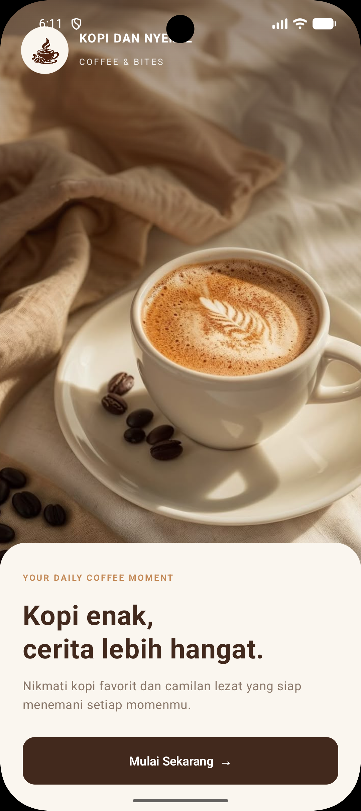</td>
    <td align="center">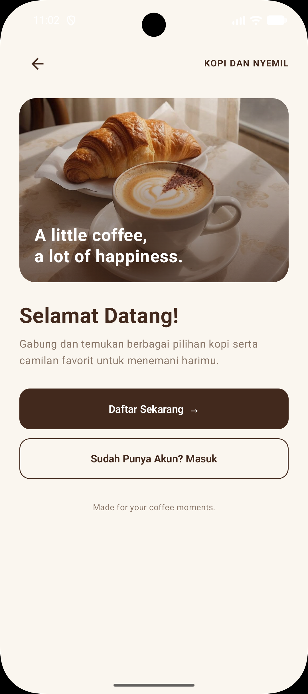</td>
    <td align="center">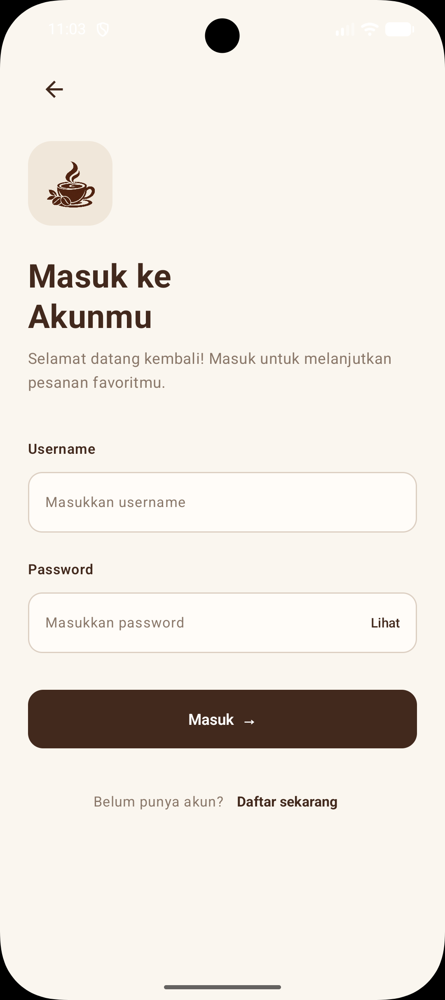</td>
    <td align="center">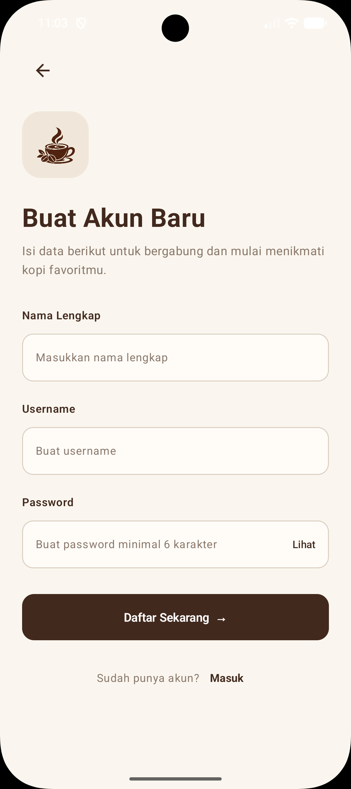</td>
  </tr>
</table>

### 5.2 Home

Halaman Home menampilkan 18 produk yang tersedia, lengkap dengan gambar, deskripsi, harga, dan tombol tambah-kurang jumlah pesanan.

Produk dapat ditampilkan berdasarkan kategori Kopi, Non Kopi, dan Camilan.

<table>
  <tr>
    <th align="center">Home 1</th>
    <th align="center">Home 2</th>
    <th align="center">Home 3</th>
    <th align="center">Home 4</th>
  </tr>
  <tr>
    <td align="center">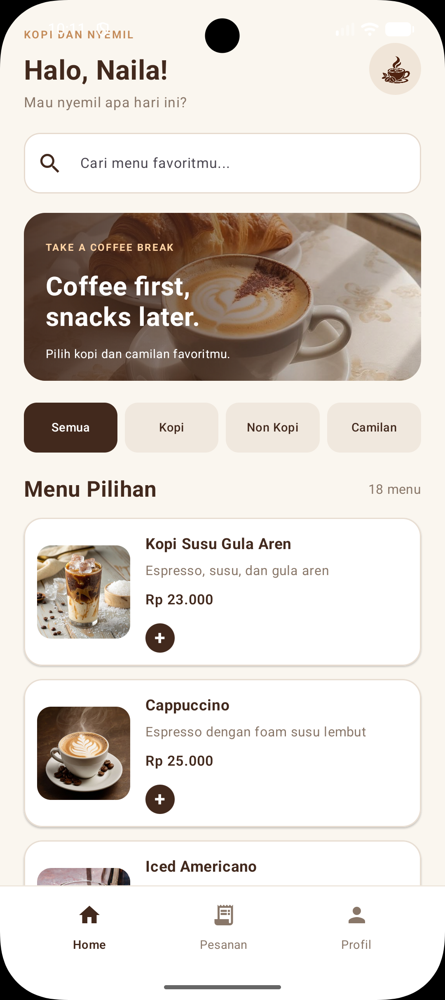</td>
    <td align="center">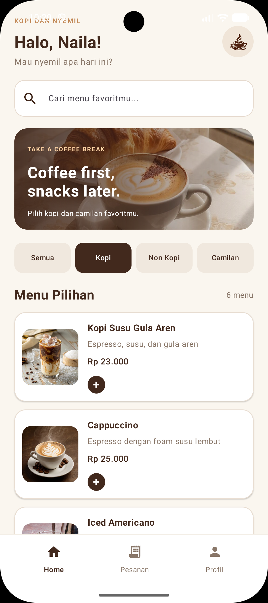</td>
    <td align="center">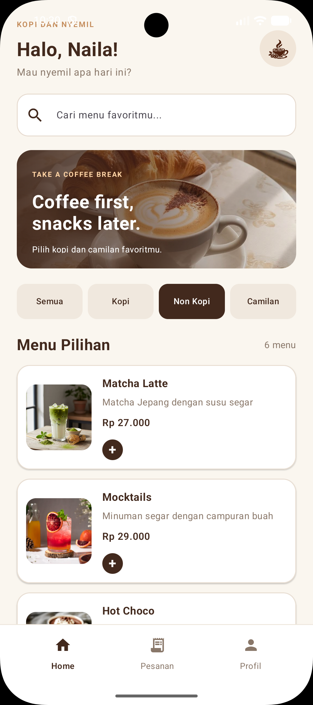</td>
    <td align="center">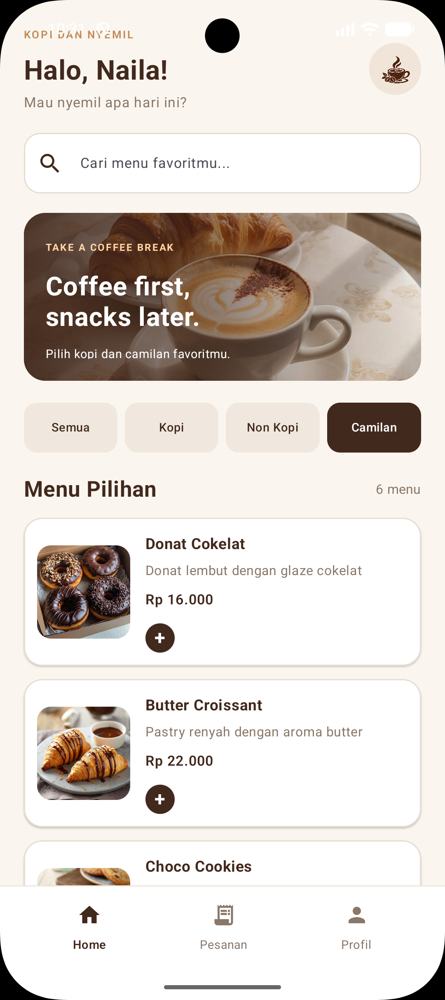</td>
  </tr>
</table>

### 5.3 Pencarian dan Pemilihan Menu

Fitur pencarian digunakan untuk menemukan produk berdasarkan nama atau deskripsi. Pengguna juga dapat memilih jumlah produk yang akan dimasukkan ke keranjang.

<table>
  <tr>
    <th align="center">Pencarian Menu</th>
    <th align="center">Pemilihan Produk</th>
  </tr>
  <tr>
    <td align="center">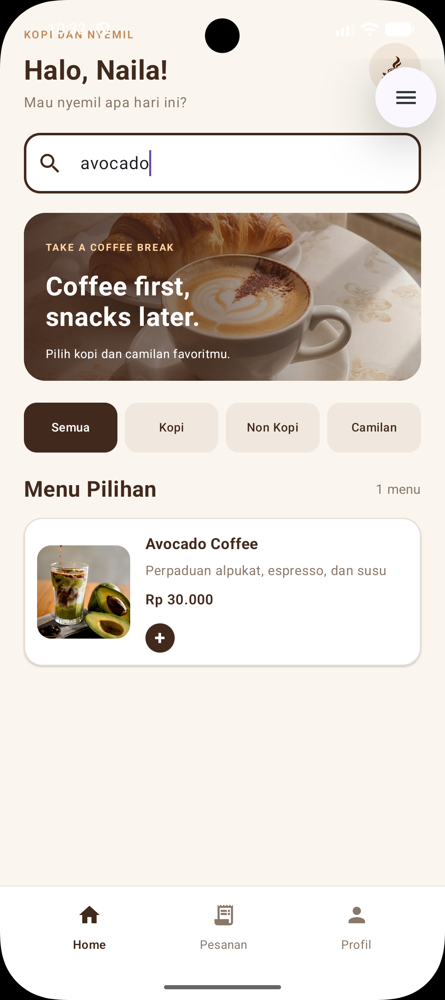</td>
    <td align="center">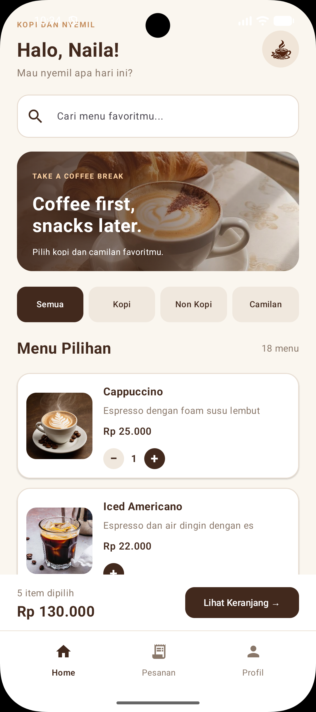</td>
  </tr>
</table>

### 5.4 Keranjang Pesanan

Pada halaman Pesanan Saya, pengguna dapat membuka tab Keranjang untuk melihat produk yang telah dipilih, mengubah jumlah pembelian, dan memeriksa total harga sebelum melanjutkan ke alamat pengiriman.

Jika belum memilih produk, aplikasi menampilkan informasi bahwa keranjang masih kosong.

<table>
  <tr>
    <th align="center">Keranjang Kosong</th>
    <th align="center">Keranjang Berisi</th>
  </tr>
  <tr>
    <td align="center">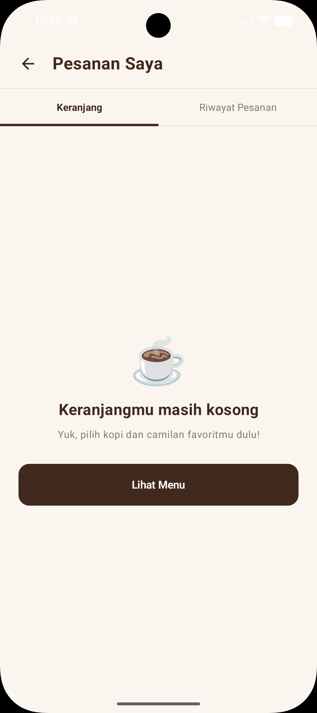</td>
    <td align="center">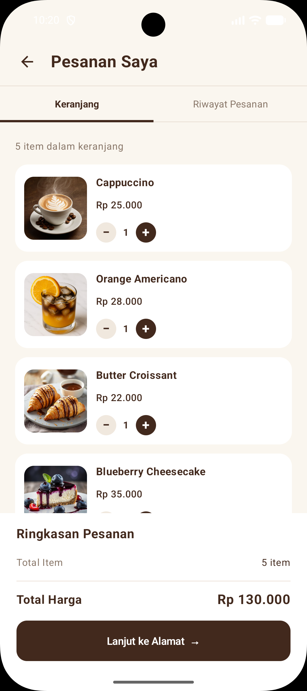</td>
  </tr>
</table>

### 5.5 Alamat Pengiriman

Pengguna mengisi nama penerima, nomor HP, alamat lengkap, dan catatan tambahan sebelum mengonfirmasi pesanan.

Halaman ini juga menampilkan ringkasan jumlah produk dan total harga. Data wajib divalidasi sebelum pesanan diproses.

<p align="center">
  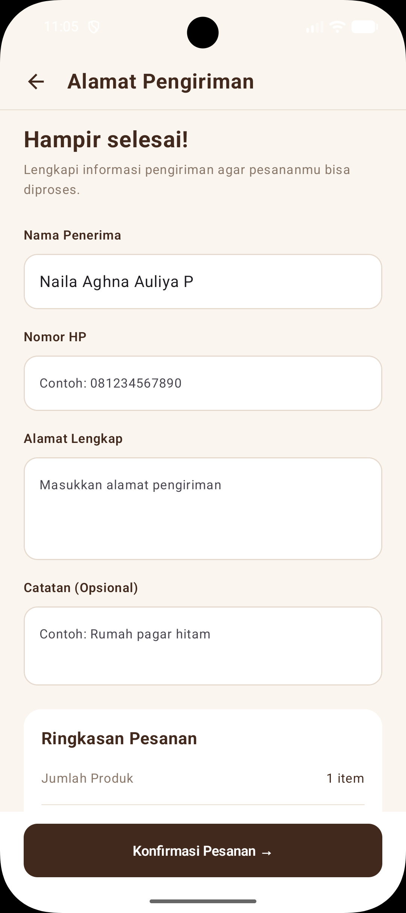
</p>

### 5.6 Konfirmasi Pesanan

Setelah proses pemesanan selesai, aplikasi menampilkan halaman konfirmasi dengan tanda berhasil, nama penerima, jumlah produk, dan total harga.

Pesanan yang telah dikonfirmasi juga akan masuk ke Riwayat Pesanan.

<p align="center">
  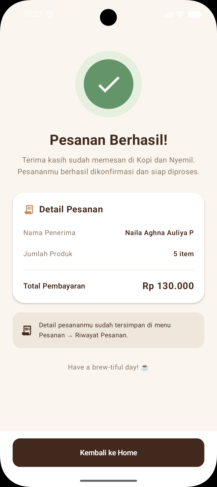
</p>

### 5.7 Riwayat Pesanan

Menu **Pesanan Saya** memiliki tab Riwayat Pesanan untuk menampilkan transaksi yang sebelumnya telah berhasil dikonfirmasi.

Setiap riwayat memuat nomor pesanan, nama penerima, daftar produk, jumlah item, dan total harga. Apabila belum ada transaksi, aplikasi menampilkan halaman riwayat kosong.

<table>
  <tr>
    <th align="center">Riwayat Kosong</th>
    <th align="center">Riwayat Pesanan</th>
  </tr>
  <tr>
    <td align="center">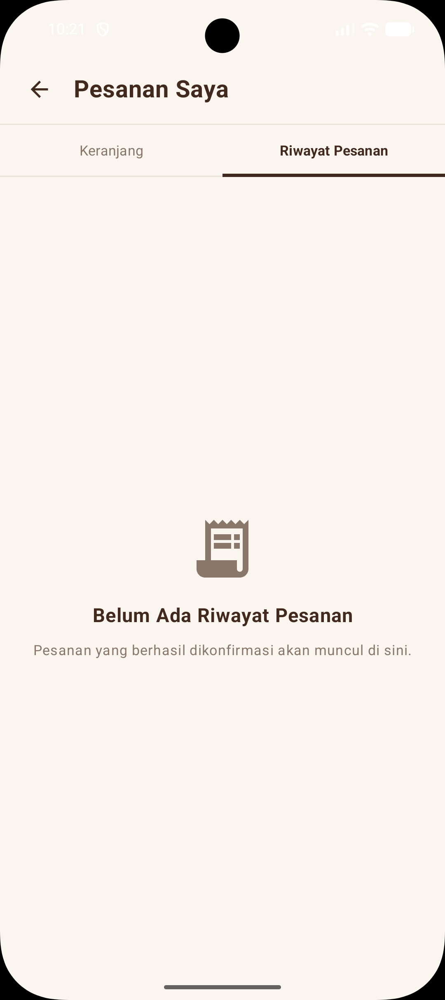</td>
    <td align="center">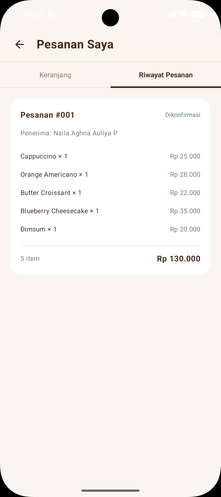</td>
  </tr>
</table>

### 5.8 Profile

Halaman Profile digunakan untuk melihat dan memperbarui informasi pribadi, meliputi nama lengkap, email, nomor HP, dan foto profil yang dapat dipilih dari galeri perangkat.

Username ditampilkan sebagai identitas akun dan tidak dapat diubah. Pengguna juga dapat keluar dari akun melalui tombol logout.

<p align="center">
  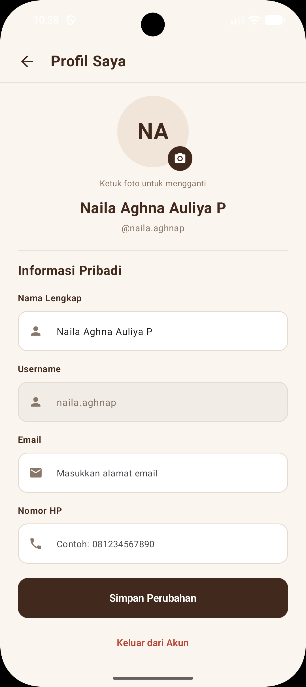
</p>

## 6. Alur Penggunaan Aplikasi

1. Pengguna membuka aplikasi melalui halaman Welcome.
2. Memilih Login atau Register untuk mengakses aplikasi.
3. Setelah login berhasil, pengguna diarahkan ke halaman Home.
4. Pengguna mencari produk atau memilih menu berdasarkan kategori.
5. Pengguna menentukan jumlah produk melalui tombol tambah (+) dan kurang (-).
6. Produk yang dipilih masuk ke menu Pesanan pada tab Keranjang.
7. Pengguna memeriksa produk, jumlah item, dan total harga.
8. Pengguna melanjutkan ke halaman Alamat Pengiriman dan melengkapi data penerima.
9. Setelah data valid, pengguna melakukan konfirmasi pesanan.
10. Aplikasi menampilkan halaman Konfirmasi Pesanan dengan ringkasan transaksi.
11. Pengguna kembali ke Home dan dapat membuka Pesanan → Riwayat Pesanan untuk melihat transaksi yang telah dikonfirmasi.
12. Pengguna dapat membuka Profile untuk memperbarui informasi pribadi, mengganti foto, atau logout.

## 7. Cara Menjalankan Aplikasi

1. Clone repository melalui terminal:

   ```bash
   git clone https://github.com/nailaauliya/KopiDanNyemil.git
   ```

2. Buka folder `KopiDanNyemil` menggunakan **Android Studio**.
3. Tunggu proses **Gradle Sync** hingga selesai.
4. Siapkan emulator Android atau perangkat Android yang kompatibel.
5. Pilih konfigurasi `app`, kemudian klik tombol **Run**.
6. Setelah aplikasi terbuka, lakukan registrasi dan login untuk mencoba fitur pemesanan.

## 8. Catatan Pengembangan

Kopi dan Nyemil merupakan aplikasi prototype yang dikembangkan untuk memenuhi tugas UTS mata kuliah Pengembangan Aplikasi Mobile.

Seluruh produk menggunakan *dummy data*. Informasi akun, keranjang, dan riwayat pesanan dikelola menggunakan state aplikasi, sedangkan email dan nomor HP pada Profile dapat disimpan secara lokal melalui SharedPreferences.

Riwayat pesanan belum menggunakan penyimpanan permanen sehingga dapat hilang ketika sesi aplikasi berakhir atau setelah logout.

Aplikasi belum terhubung dengan database server, backend, sistem pembayaran, maupun layanan pengiriman sebenarnya. Proses pemesanan dan konfirmasi merupakan simulasi untuk kebutuhan pembelajaran.

---

**Kopi dan Nyemil — UTS Pengembangan Aplikasi Mobile**

**Naila Aghna Auliya Prayitno | 1247050051 | Kelas C**
