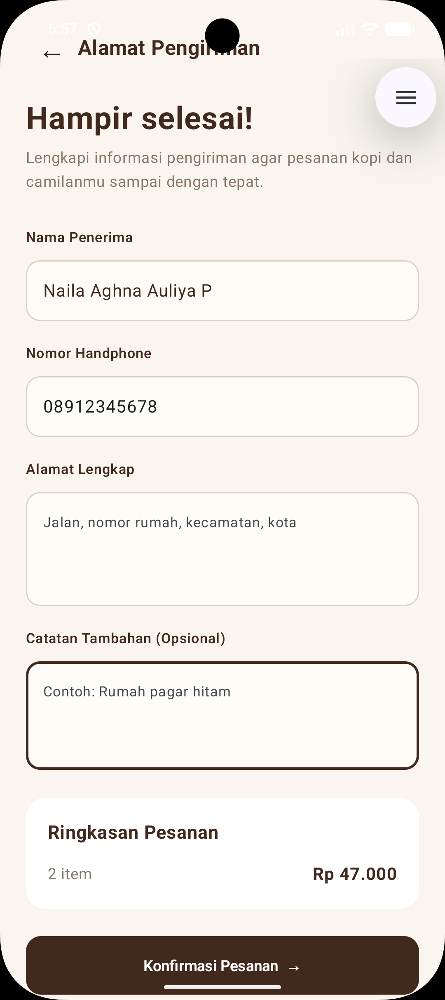

# Kopi dan Nyemil

## Ujian Tengah Semester (UTS)
### Mata Kuliah Pengembangan Aplikasi Mobile

**Identitas Mahasiswa**

| Keterangan | Data |
|---|---|
| Nama | Naila Aghna Auliya Prayitno |
| NIM | 1247050051 |
| Kelas | C |

---

## 1. Deskripsi Aplikasi

**Kopi dan Nyemil** merupakan aplikasi pemesanan kopi dan camilan berbasis Android yang dikembangkan menggunakan Kotlin dan Jetpack Compose melalui Android Studio.

Aplikasi ini dibuat untuk memenuhi tugas Ujian Tengah Semester (UTS) mata kuliah Pengembangan Aplikasi Mobile berdasarkan wireframe yang telah diberikan.

Aplikasi menyediakan fitur registrasi dan login, daftar menu makanan dan minuman, pencarian dan filter kategori, pemilihan produk, keranjang pesanan, pengelolaan profil, pengisian alamat pengiriman, serta konfirmasi pesanan.

Halaman Home menyediakan **12 produk makanan dan minuman** yang terdiri dari kategori Kopi, Non Kopi, dan Camilan. Data produk masih menggunakan data statis (*dummy data*) tanpa database.

## 2. Fitur Aplikasi

| No. | Fitur | Keterangan |
|---|---|---|
| 1 | Welcome | Menampilkan halaman pembuka aplikasi. |
| 2 | Sign Up | Menampilkan pilihan Login dan Register. |
| 3 | Register | Form pendaftaran akun pengguna baru. |
| 4 | Login | Masuk menggunakan akun yang telah didaftarkan. |
| 5 | Home | Menampilkan 12 produk makanan dan minuman beserta foto, nama, deskripsi, dan harga. |
| 6 | Pencarian Menu | Mencari produk berdasarkan nama atau deskripsi. |
| 7 | Filter Kategori | Menampilkan produk sesuai kategori Kopi, Non Kopi, dan Camilan. |
| 8 | Pemilihan Produk | Menambah dan mengurangi jumlah produk menggunakan tombol (+) dan (-). |
| 9 | Keranjang | Menampilkan produk yang dipilih beserta jumlah dan total harga. |
| 10 | Profile | Menampilkan dan mengubah nama serta foto profil pengguna. |
| 11 | Alamat Pengiriman | Mengisi nama penerima, nomor handphone, alamat lengkap, dan catatan tambahan. |
| 12 | Konfirmasi Pesanan | Menampilkan informasi pesanan yang berhasil dikonfirmasi. |

## 3. Daftar Menu

Aplikasi menyediakan 12 produk yang dikelompokkan ke dalam tiga kategori.

| No. | Nama Produk | Kategori | Harga |
|---|---|---|---|
| 1 | Kopi Susu Gula Aren | Kopi | Rp23.000 |
| 2 | Cappuccino | Kopi | Rp25.000 |
| 3 | Iced Americano | Kopi | Rp22.000 |
| 4 | Orange Americano | Kopi | Rp28.000 |
| 5 | Matcha Latte | Non Kopi | Rp27.000 |
| 6 | Mocktails | Non Kopi | Rp29.000 |
| 7 | Donat Cokelat | Camilan | Rp16.000 |
| 8 | Butter Croissant | Camilan | Rp22.000 |
| 9 | Choco Cookies | Camilan | Rp15.000 |
| 10 | Blueberry Cheesecake | Camilan | Rp35.000 |
| 11 | Dimsum | Camilan | Rp20.000 |
| 12 | Cireng | Camilan | Rp15.000 |

Seluruh produk ditampilkan pada halaman Home dengan foto, deskripsi singkat, dan harga. Pengguna dapat mencari produk, memilih kategori, serta menambahkan produk ke keranjang.

## 4. Teknologi yang Digunakan

| Teknologi | Keterangan |
|---|---|
| Kotlin | Bahasa pemrograman aplikasi. |
| Jetpack Compose | Framework pengembangan antarmuka Android. |
| Material Design 3 | Komponen antarmuka aplikasi. |
| Android Studio | IDE untuk pengembangan aplikasi. |
| Gradle | Build system project Android. |
| Android SDK | Minimum API 35. |
| Git dan GitHub | Version control dan penyimpanan source code. |

## 5. Dokumentasi Tampilan Aplikasi

Berikut hasil implementasi halaman dan fitur aplikasi Kopi dan Nyemil.

### 5.1 Welcome, Sign Up, Login, dan Register

Halaman awal digunakan untuk mengarahkan pengguna ke proses autentikasi. Pengguna dapat melakukan registrasi terlebih dahulu sebelum masuk ke aplikasi melalui halaman Login.

<table>
  <tr>
    <th align="center">Welcome</th>
    <th align="center">Sign Up</th>
    <th align="center">Login</th>
    <th align="center">Register</th>
  </tr>
  <tr>
    <td></td>
    <td></td>
    <td></td>
    <td></td>
  </tr>
</table>

### 5.2 Home

Halaman Home menampilkan **12 menu makanan dan minuman** yang terdiri dari 4 produk Kopi, 2 produk Non Kopi, dan 6 produk Camilan.

Setiap menu dilengkapi foto produk, nama, deskripsi singkat, harga, serta tombol untuk menambah dan mengurangi jumlah pesanan. Pengguna dapat melihat produk dengan menggulir daftar menu ke bawah.

<table>
  <tr>
    <th align="center">Home - Tampilan 1</th>
    <th align="center">Home - Tampilan 2</th>
    <th align="center">Home - Tampilan 3</th>
  </tr>
  <tr>
    <td></td>
    <td></td>
    <td></td>
  </tr>
</table>

### 5.3 Pencarian dan Pemilihan Menu

Fitur pencarian digunakan untuk menemukan produk berdasarkan nama atau deskripsi. Pengguna juga dapat menggunakan filter kategori untuk menampilkan jenis menu tertentu.

Pemilihan produk dilakukan menggunakan tombol tambah (+) dan kurang (-). Jumlah pesanan dan total harga akan diperbarui sesuai produk yang dipilih.

<table>
  <tr>
    <th align="center">Pencarian Menu</th>
    <th align="center">Pemilihan Produk</th>
  </tr>
  <tr>
    <td></td>
    <td></td>
  </tr>
</table>

### 5.4 Keranjang Pesanan

Halaman Keranjang menampilkan daftar produk yang telah dipilih beserta jumlah dan total harga pesanan.

Pengguna dapat mengubah jumlah produk sebelum melanjutkan ke pengisian alamat pengiriman. Jika belum ada produk yang dipilih, aplikasi akan menampilkan informasi keranjang kosong.

<table>
  <tr>
    <th align="center">Keranjang Kosong</th>
    <th align="center">Keranjang Berisi Produk</th>
  </tr>
  <tr>
    <td></td>
    <td></td>
  </tr>
</table>

### 5.5 Profile

Halaman Profile menampilkan informasi akun pengguna berupa nama lengkap dan username. Pengguna dapat mengubah nama lengkap, memilih foto profil dari galeri, dan keluar dari akun.

<p align="center">
  
</p>

### 5.6 Alamat Pengiriman

Halaman Alamat Pengiriman digunakan untuk mengisi informasi penerima, nomor handphone, alamat lengkap, dan catatan tambahan apabila diperlukan.

Halaman ini juga menampilkan ringkasan jumlah produk dan total harga sebelum pesanan dikonfirmasi.

<p align="center">
  
</p>

### 5.7 Konfirmasi Pesanan

Setelah pengguna melengkapi informasi pengiriman dan menekan tombol konfirmasi, aplikasi menampilkan halaman pesanan berhasil.

Halaman ini memuat nama penerima, jumlah produk, dan total harga pesanan.

<p align="center">
  
</p>

## 6. Alur Penggunaan Aplikasi

1. Pengguna membuka aplikasi melalui halaman Welcome.
2. Pengguna memilih Login atau Register.
3. Jika belum memiliki akun, pengguna melakukan registrasi terlebih dahulu.
4. Setelah login berhasil, pengguna masuk ke halaman Home.
5. Pengguna dapat melihat 12 produk, mencari menu, atau memilih kategori.
6. Pengguna memilih produk menggunakan tombol tambah (+) dan kurang (-).
7. Produk yang dipilih masuk ke halaman Keranjang.
8. Pengguna memeriksa dan mengubah jumlah pesanan apabila diperlukan.
9. Pengguna melanjutkan ke halaman Alamat Pengiriman.
10. Pengguna mengisi informasi penerima dan alamat.
11. Setelah pesanan dikonfirmasi, aplikasi menampilkan halaman Konfirmasi Pesanan.
12. Pengguna dapat kembali ke Home untuk melakukan pemesanan berikutnya.

## 7. Cara Menjalankan Aplikasi

1. Clone repository melalui terminal:

   ```bash
   git clone https://github.com/nailaauliya/KopiDanNyemil.git
   ```

2. Buka Android Studio.
3. Pilih **Open**, kemudian buka folder `KopiDanNyemil`.
4. Tunggu proses Gradle Sync hingga selesai.
5. Jalankan emulator atau hubungkan perangkat Android dengan API 35 atau lebih tinggi.
6. Pilih konfigurasi `app`, lalu klik **Run**.
7. Lakukan registrasi dan login untuk menggunakan aplikasi.

## 8. Catatan Pengembangan

Kopi dan Nyemil merupakan prototype yang dikembangkan untuk memenuhi tugas Ujian Tengah Semester mata kuliah Pengembangan Aplikasi Mobile.

Data produk masih menggunakan data statis, sedangkan data akun, profil, dan keranjang dikelola sementara melalui state aplikasi.

Aplikasi belum menggunakan database, backend server, sistem pembayaran, maupun layanan pengiriman yang terintegrasi.

---

**UTS Pengembangan Aplikasi Mobile — Kopi dan Nyemil**
