# Kopi dan Nyemil

### Ujian Tengah Semester — Pengembangan Aplikasi Mobile

| Identitas | Keterangan |
|---|---|
| Nama | Naila Aghna Auliya Prayitno |
| NIM | 1247050051 |
| Kelas | C |
| Mata Kuliah | Pengembangan Aplikasi Mobile |

---

## 1. Deskripsi Aplikasi

**Kopi dan Nyemil** merupakan aplikasi pemesanan kopi dan camilan berbasis Android yang dikembangkan menggunakan **Kotlin** dan **Jetpack Compose** melalui Android Studio.

Aplikasi ini dibuat untuk memenuhi tugas Ujian Tengah Semester (UTS) mata kuliah Pengembangan Aplikasi Mobile dengan mengimplementasikan wireframe yang telah diberikan.

Melalui aplikasi ini, pengguna dapat melakukan registrasi dan login, melihat daftar menu, mencari produk, memilih jumlah pesanan, mengelola keranjang, mengisi alamat pengiriman, hingga melakukan konfirmasi pesanan.

Aplikasi menyediakan **18 produk** yang terbagi menjadi tiga kategori, yaitu **Kopi, Non Kopi, dan Camilan**. Seluruh data produk masih menggunakan data statis (*dummy data*) tanpa database.

## 2. Fitur Aplikasi

Aplikasi Kopi dan Nyemil memiliki beberapa fitur utama yang mendukung proses pemesanan makanan dan minuman.

| No. | Fitur | Keterangan |
|---|---|---|
| 1 | Welcome | Halaman pembuka yang menampilkan identitas aplikasi sebelum pengguna melanjutkan ke halaman berikutnya. |
| 2 | Sign Up | Menyediakan pilihan untuk masuk menggunakan akun yang sudah ada atau melakukan pendaftaran akun baru. |
| 3 | Register | Memungkinkan pengguna membuat akun dengan mengisi informasi nama, username, dan password. |
| 4 | Login | Memvalidasi username dan password yang telah didaftarkan sebelum pengguna dapat masuk ke halaman utama. |
| 5 | Home | Menampilkan 18 pilihan kopi, minuman non-kopi, dan camilan yang dilengkapi gambar, nama, deskripsi, serta harga. |
| 6 | Pencarian Menu | Memudahkan pengguna menemukan produk melalui pencarian berdasarkan nama atau deskripsi. |
| 7 | Filter Kategori | Menampilkan produk berdasarkan kategori Semua, Kopi, Non Kopi, dan Camilan. |
| 8 | Pemilihan Produk | Pengguna dapat menambah atau mengurangi jumlah produk melalui tombol (+) dan (-). |
| 9 | Keranjang | Menampilkan produk yang dipilih, jumlah pesanan, dan total harga yang diperbarui secara otomatis. |
| 10 | Alamat Pengiriman | Menyediakan formulir nama penerima, nomor handphone, alamat lengkap, dan catatan tambahan. |
| 11 | Konfirmasi Pesanan | Menampilkan ringkasan pesanan yang telah dikonfirmasi, termasuk nama penerima, jumlah produk, dan total harga. |
| 12 | Profile | Menampilkan informasi akun serta menyediakan fitur mengubah nama, memilih foto profil, dan logout. |

Aplikasi juga dilengkapi dengan **bottom navigation** untuk memudahkan perpindahan dari halaman Home ke Keranjang dan Profile.

## 3. Daftar Menu

Terdapat **18 produk** yang tersedia, terdiri dari **6 menu Kopi, 6 menu Non Kopi, dan 6 menu Camilan**.

| Kategori | Nama Produk | Harga |
|---|---|---|
| **Kopi** | Kopi Susu Gula Aren | Rp23.000 |
| | Cappuccino | Rp25.000 |
| | Iced Americano | Rp22.000 |
| | Orange Americano | Rp28.000 |
| | Caramel Frappuccino | Rp32.000 |
| | Avocado Coffee | Rp30.000 |
| **Non Kopi** | Matcha Latte | Rp27.000 |
| | Mocktails | Rp29.000 |
| | Hot Choco | Rp25.000 |
| | Cookies n Cream Frappe | Rp30.000 |
| | Red Velvet Milkshake | Rp30.000 |
| | Mango Pomelo | Rp29.000 |
| **Camilan** | Donat Cokelat | Rp16.000 |
| | Butter Croissant | Rp22.000 |
| | Choco Cookies | Rp15.000 |
| | Blueberry Cheesecake | Rp35.000 |
| | Dimsum | Rp20.000 |
| | Cireng | Rp15.000 |

Setiap produk ditampilkan dengan foto, deskripsi singkat, harga, serta tombol untuk mengatur jumlah pesanan.

## 4. Teknologi yang Digunakan

| No. | Teknologi | Keterangan |
|---|---|---|
| 1 | Kotlin | Bahasa pemrograman utama untuk pengembangan aplikasi Android. |
| 2 | Jetpack Compose | Framework untuk membangun antarmuka aplikasi secara deklaratif. |
| 3 | Material Design 3 | Menyediakan komponen UI seperti tombol, kartu produk, dan kolom input. |
| 4 | Material Icons | Digunakan untuk ikon pencarian serta navigasi Home, Keranjang, dan Profil. |
| 5 | Android Studio | IDE untuk menulis kode, membangun, dan menguji aplikasi. |
| 6 | Gradle | Mengelola dependency dan proses build aplikasi. |
| 7 | Android SDK | Mendukung pengembangan aplikasi dengan minimum API 35 (Android 15). |
| 8 | Git & GitHub | Digunakan untuk version control, penyimpanan source code, dan dokumentasi project. |

## 5. Dokumentasi Tampilan Aplikasi

Berikut merupakan hasil implementasi antarmuka aplikasi Kopi dan Nyemil berdasarkan wireframe yang telah dikembangkan.

### 5.1 Welcome, Sign Up, Login, dan Register

Halaman awal aplikasi digunakan untuk memulai, membuat akun baru, dan login sebelum masuk ke halaman utama.

<table>
  <tr>
    <th align="center">Welcome</th>
    <th align="center">Sign Up</th>
    <th align="center">Login</th>
    <th align="center">Register</th>
  </tr>
  <tr>
    <td align="center"></td>
    <td align="center">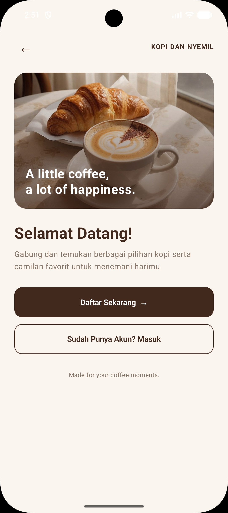</td>
    <td align="center">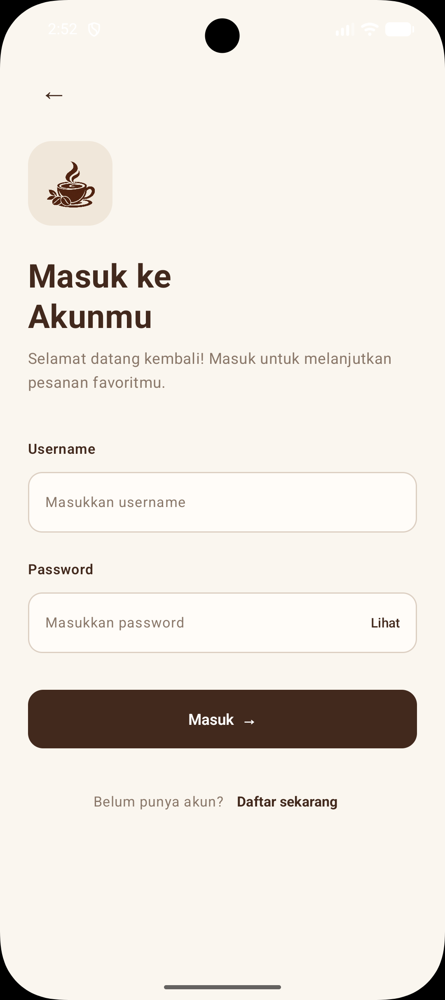</td>
    <td align="center">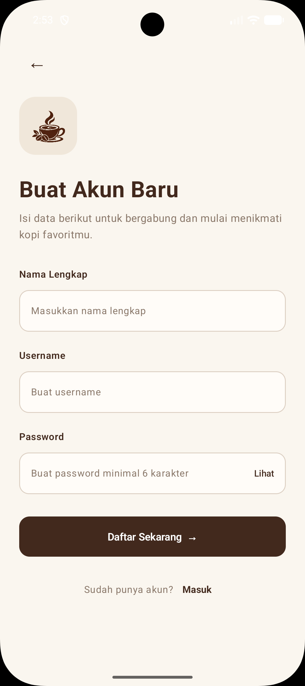</td>
  </tr>
</table>

### 5.2 Home

Halaman Home menampilkan daftar produk yang tersedia, lengkap dengan gambar, deskripsi, harga, dan tombol pemilihan jumlah produk. Menu disusun berdasarkan kategori agar lebih mudah ditemukan.

<table>
  <tr>
    <th align="center">Home 1</th>
    <th align="center">Home 2</th>
    <th align="center">Home 3</th>
    <th align="center">Home 4</th>
  </tr>
  <tr>
    <td align="center">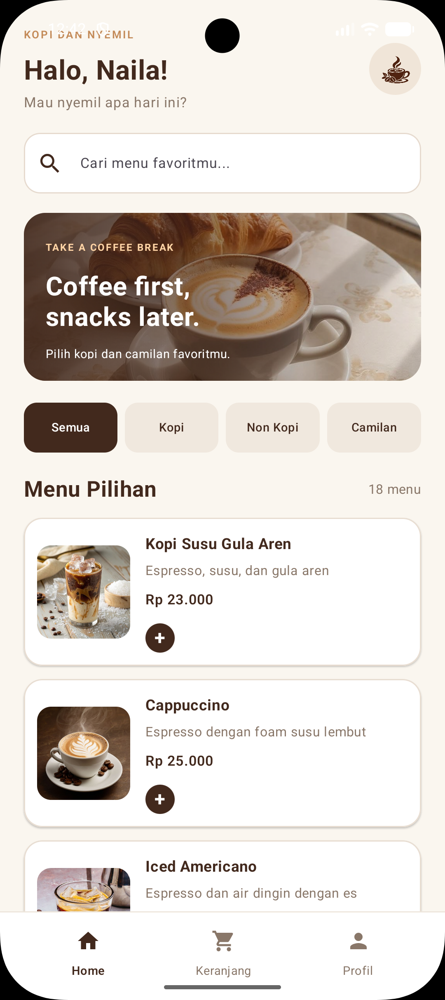</td>
    <td align="center">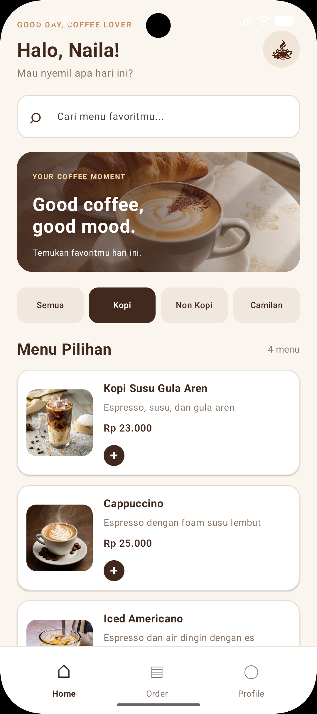</td>
    <td align="center">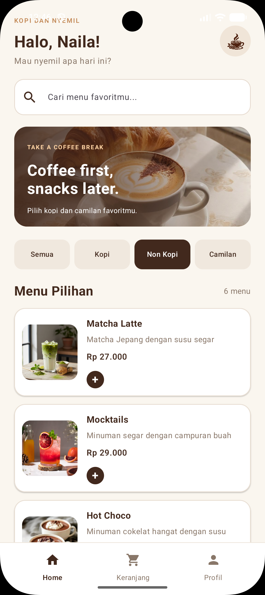</td>
    <td align="center">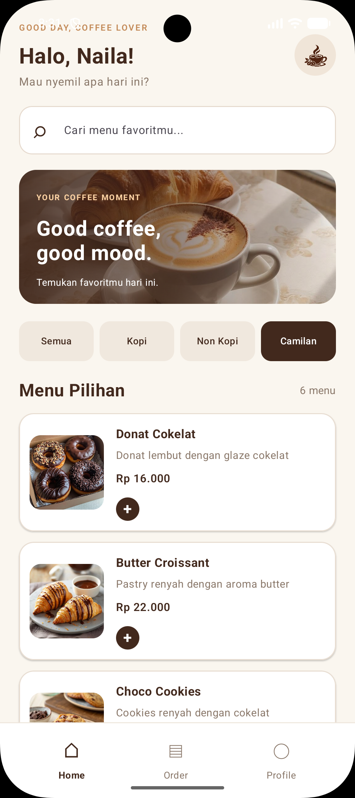</td>
  </tr>
</table>

### 5.3 Pencarian dan Pemilihan Menu

Fitur pencarian memungkinkan pengguna menemukan produk berdasarkan nama atau deskripsi. Pengguna juga dapat menggunakan filter kategori serta menambah atau mengurangi jumlah produk yang ingin dipesan.

<table>
  <tr>
    <th align="center">Pencarian Menu</th>
    <th align="center">Pemilihan Produk</th>
  </tr>
  <tr>
    <td align="center">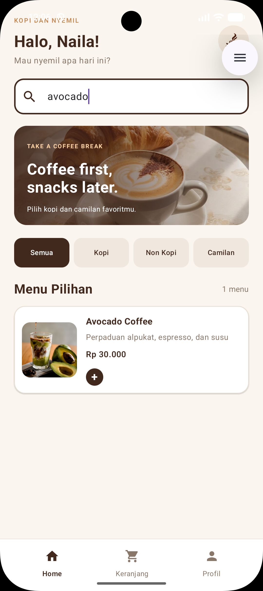</td>
    <td align="center">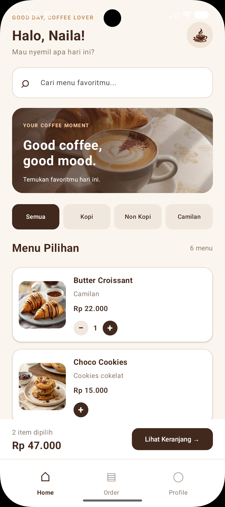</td>
  </tr>
</table>

### 5.4 Keranjang Pesanan

Halaman Keranjang digunakan untuk melihat produk yang telah dipilih, mengatur jumlah pesanan, dan memeriksa total harga sebelum melanjutkan ke proses checkout.

Jika belum ada produk yang dipilih, aplikasi akan menampilkan informasi bahwa keranjang masih kosong.

<table>
  <tr>
    <th align="center">Keranjang Kosong</th>
    <th align="center">Keranjang Pesanan</th>
  </tr>
  <tr>
    <td align="center">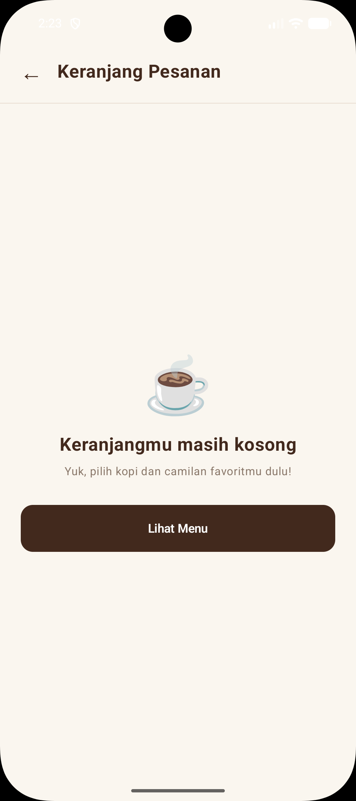</td>
    <td align="center">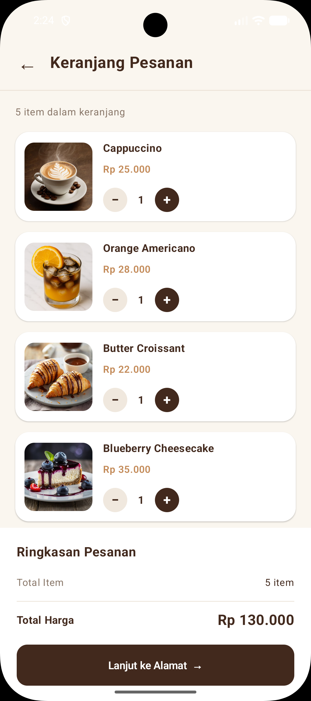</td>
  </tr>
</table>

### 5.5 Alamat Pengiriman

Pengguna mengisi informasi penerima, nomor handphone, alamat lengkap, dan catatan tambahan sebelum mengonfirmasi pesanan. Halaman ini juga menampilkan ringkasan jumlah produk dan total harga.

<p align="center">
  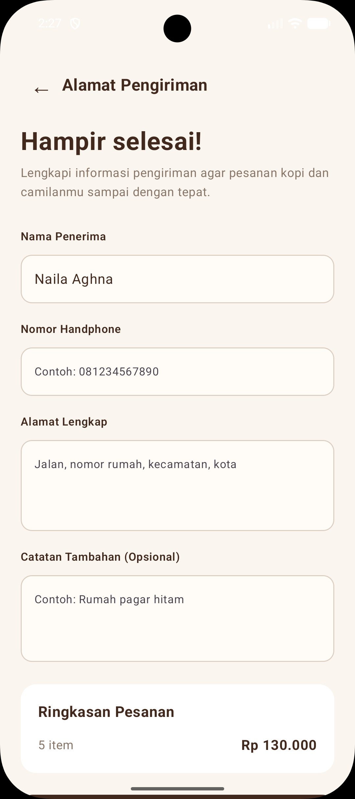
</p>

### 5.6 Konfirmasi Pesanan

Setelah pengguna menyelesaikan proses pemesanan, aplikasi menampilkan halaman konfirmasi yang berisi nama penerima, jumlah produk, dan total harga pesanan.

<p align="center">
  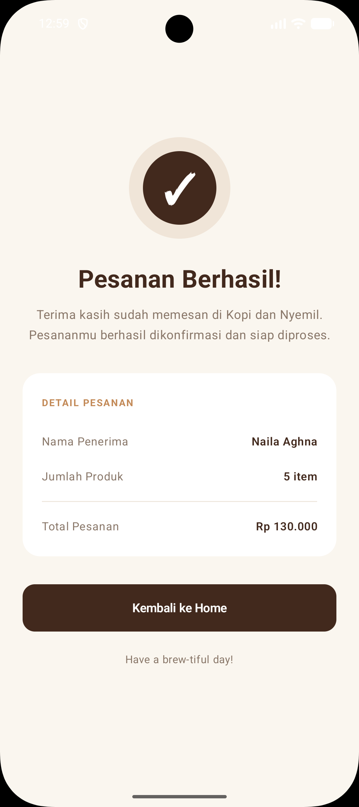
</p>

### 5.7 Profile

Halaman Profile digunakan untuk melihat informasi akun, memperbarui nama, memilih foto profil dari galeri perangkat, dan melakukan logout.

<p align="center">
  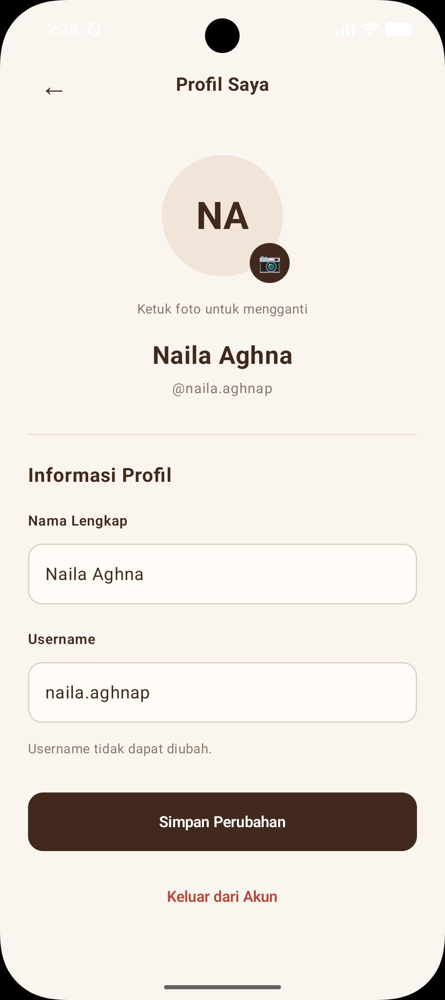
</p>

## 6. Alur Penggunaan Aplikasi

1. Pengguna membuka aplikasi melalui halaman Welcome.
2. Memilih Login atau Register untuk mengakses aplikasi.
3. Setelah login, pengguna diarahkan ke halaman Home.
4. Pengguna mencari atau memilih produk serta menentukan jumlah pesanan.
5. Produk yang dipilih akan ditampilkan pada halaman Keranjang.
6. Pengguna memeriksa pesanan dan mengisi informasi Alamat Pengiriman.
7. Setelah data lengkap, pengguna melakukan konfirmasi pesanan.
8. Aplikasi menampilkan halaman Konfirmasi Pesanan dan pengguna dapat kembali ke Home.

Selain melakukan pemesanan, pengguna dapat mengakses halaman Profile untuk mengelola informasi akun.

## 7. Cara Menjalankan Aplikasi

1. Clone repository melalui terminal:

   ```bash
   git clone https://github.com/nailaauliya/KopiDanNyemil.git
   ```

2. Buka folder `KopiDanNyemil` menggunakan **Android Studio**.
3. Tunggu proses **Gradle Sync** hingga selesai.
4. Jalankan emulator atau perangkat Android dengan **API 35 atau lebih tinggi**.
5. Pilih konfigurasi `app`, kemudian klik **Run**.
6. Lakukan registrasi dan login untuk mencoba fitur aplikasi.

## 8. Catatan Pengembangan

Kopi dan Nyemil merupakan aplikasi prototype yang dikembangkan untuk memenuhi tugas UTS Pengembangan Aplikasi Mobile.

Data produk menggunakan *dummy data*, sedangkan informasi akun dan keranjang dikelola sementara melalui state aplikasi. Aplikasi belum terhubung dengan database, backend, sistem pembayaran, maupun layanan pengiriman sebenarnya.

---

**Kopi dan Nyemil — UTS Pengembangan Aplikasi Mobile**

**Naila Aghna Auliya Prayitno | 1247050051 | Kelas C**
